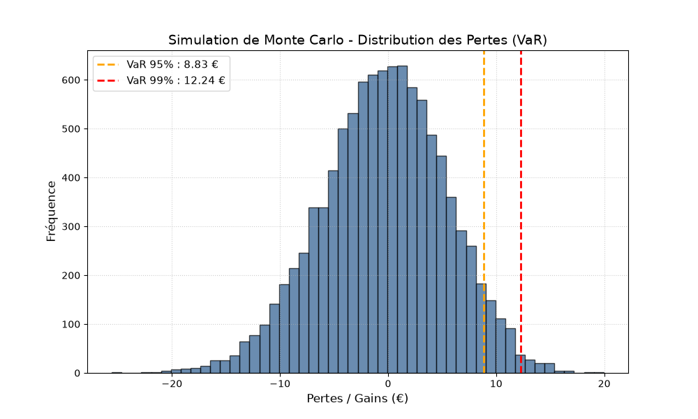

# Simulation de Monte-Carlo & Calcul de la Value at Risk (VaR)

Ce projet met en œuvre des méthodes numériques de **Simulation de Monte-Carlo** pour l'estimation de la **Value at Risk (VaR 95% et 99%)** d'un actif financier sur un horizon de 30 jours, basée sur le **Mouvement Brownien Géométrique (GBM)**.

## 📌 Contenu du Projet

- **`monte_carlo_var.py`** : Script Python réalisant la simulation stochastique (10 000 simulations) et le calcul des centiles de perte (VaR).
- **`monte_carlo_var.png`** : Histogramme de la distribution des pertes avec seuils de confiance.
- **`monte_carlo_var.pdf`** : Rapport académique rédigé en $\LaTeX$ détaillant le cadre mathématique et l'analyse du risque.

## 🛠️ Technologies Utilisées

* **Python** (`NumPy`, `Matplotlib`)
* **$\LaTeX$** (Rédaction du rapport théorique)

## 📄 Rapport Académique

Pour consulter les démonstrations théoriques et l'analyse détaillée du risque :  

👉 **[Consulter le rapport complet (PDF)](./monte_carlo_var.pdf)**
## 📊 Aperçu des Résultats

